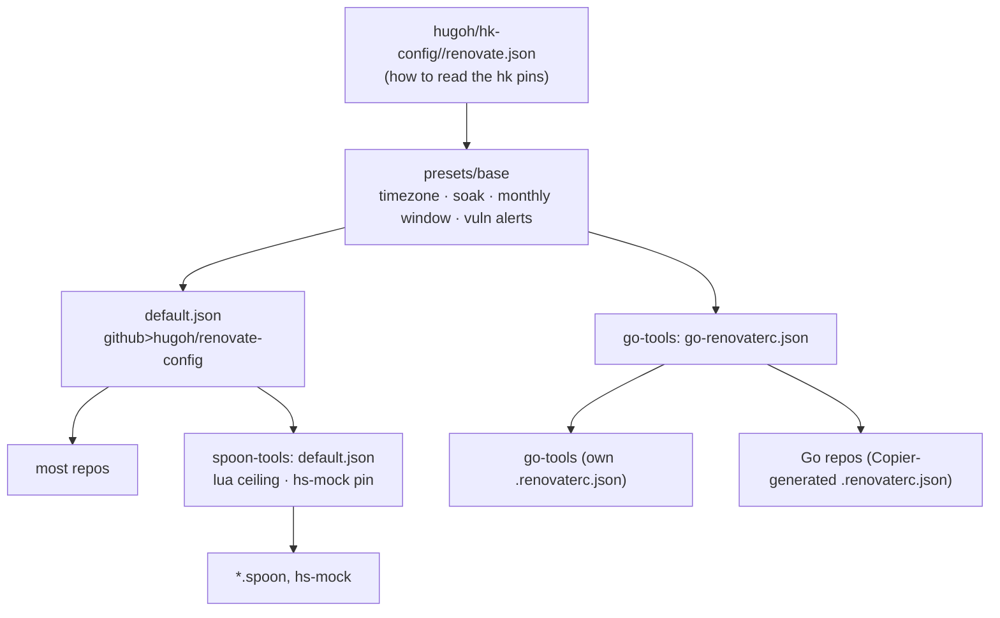

# renovate-config

Shared [Renovate](https://docs.renovatebot.com/) config for my repos, hosted as a
[preset](https://docs.renovatebot.com/config-presets/).

## Usage

```json
{
  "$schema": "https://docs.renovatebot.com/renovate-schema.json",
  "extends": ["github>hugoh/renovate-config"]
}
```

Repos with their own additional rules (version pins, extra managers, etc.) list
`github>hugoh/renovate-config` first in their `extends` array and add their own
`packageRules` afterward.

## How it all fits together

Every repo extends one of three hubs, and all three sit on
[`presets/base`][base]:



- **`github>hugoh/renovate-config`** ([`default.json`][default],
  [repos that use it][default-users]): every repo that isn't a spoon or a Go
  project, plus `spoon-tools` itself. Releasing repos add
  `presets/action-repo` (`gh-workflows`) or `presets/action-file` (`cog-bump`,
  `digest-action`, `rerun-transient-failures`, `checkly-config`); `spoon-tools`
  types only the bumps in its published `spoon-release.yml` as `fix`.
- **`github>hugoh/spoon-tools`** ([`default.json`][spoon],
  [repos that use it][spoon-users]): the Hammerspoon spoons and `hs-mock`. It is
  `default.json` plus a `lua` ceiling and a regex manager for the
  `HS_MOCK_VERSION` pin in `mise.toml`.
- **`github>hugoh/go-tools:go-renovaterc`** ([`go-renovaterc.json`][go],
  [repos that use it][go-users]): the Go repos. It does **not**
  extend `default.json`: it has its own groups (`GitHub Actions`,
  `Go dependencies`) and runs everything on the weekend window except majors.
  The Go repos' `.renovaterc.json` is itself a Copier output that adds
  [`presets/binary`][go-binary] or [`presets/library`][go-library] and
  [`presets/copier-owned-files`][go-copier].

### Who moves which pin

| Pin | Moved by |
|---|---|
| Ordinary dependencies, actions, `mise.toml` tools | Renovate, per the hub's groups |
| `jdx/hk` and `hugoh/hk-config` in `*.pkl` / `mise.toml` | Renovate, through [hk-config's custom managers][hk-config] (the built-in `mise` manager is off for `hk`) |
| A Go repo's `mise.toml`, `hk.pkl`, `ci.yml` / `semantic-pr.yml` workflow pins | Copier only: `copier-owned-files` and `go-renovaterc` switch Renovate off for them, and the go-tools template update PR brings the new pins |
| The same pins in go-tools' `template/` | Renovate in go-tools (`template dev tools`, typed `fix` so a release fans them out) |
| A Go repo's toolchain (`.config/mise/conf.d/go.toml`) | Renovate (seeded once by Copier, then never re-rendered) |
| Spoon versions in chezmoi's `hammerspoon.yaml` | [chezmoi's own regex manager][chezmoi] |

### When things land

| Window | What |
|---|---|
| Any time | Vulnerability fixes (6-hour soak), `first-party core` in the repos that own it (12 hours), Go patch toolchain bumps in binary repos (1 day) |
| Saturday before 5am | `renovate CLI` |
| Weekend (Fri 5pm–Sun 5am) | `minor updates`, `patch updates`, `first-party updates`; in the Go hub, everything but majors, including the go-tools template update |
| First weekend of the month | Majors, lock file maintenance, `linters` (with hk and hk-config), `biome toolchain`; go-tools' `dev tools` / `template dev tools` |
| Repo-specific | chezmoi runs `hugoh/**` (except hk-config) daily and lock files weekly; go-tools keeps `golangci-lint` weekly |

Soaks: 7 days for third parties (`presets/base`), 1 day for `hugoh/**`
(`presets/first-party-soak`), and 7 days for hk-config so it can't mature before
the hk it needs.

### How Renovate resolves a group

Checked against Renovate 44's `workers/repository/updates/generate.js`. These
rules explain most of the rule-order constraints below:

- **Schedule**: the branch takes the config of the update whose `depName` sorts
  first, so a group whose members have different schedules runs on an
  arbitrary one. Every group here has a single schedule; a consumer override
  that only matches some members of a group (a daily `hugoh/**` rule, a
  catch-all `groupName`) breaks that.
- **Soak**: each update matures on its own. A group branch drops the members
  still inside their `minimumReleaseAge` and picks them up on a later run, which
  is why hk and hk-config share the 7-day soak.
- **Commit type**: the highest-priority type among the members wins (`fix` over
  `chore`), so one `fix` member makes the whole group cut a release.
- **Automerge**: only when every member allows it.

[base]: presets/base.json
[default]: default.json
[default-users]: https://github.com/search?q=org%3Ahugoh+%22github%3Ehugoh%2Frenovate-config%22+path%3A%2F%28%5E%7C%5C%2F%29%5C.%3Frenovate%28rc%29%3F%5C.json%24%2F&type=code
[spoon]: https://github.com/hugoh/spoon-tools/blob/main/default.json
[spoon-users]: https://github.com/search?q=org%3Ahugoh+%22github%3Ehugoh%2Fspoon-tools%22&type=code
[go]: https://github.com/hugoh/go-tools/blob/main/go-renovaterc.json
[go-users]: https://github.com/search?q=org%3Ahugoh+%22github%3Ehugoh%2Fgo-tools%3Ago-renovaterc%22&type=code
[go-binary]: https://github.com/hugoh/go-tools/blob/main/presets/binary.json
[go-library]: https://github.com/hugoh/go-tools/blob/main/presets/library.json
[go-copier]: https://github.com/hugoh/go-tools/blob/main/presets/copier-owned-files.json
[hk-config]: https://github.com/hugoh/hk-config/blob/main/renovate.json
[chezmoi]: https://github.com/hugoh/config/blob/chezmoi/.renovaterc.json

## What the base config does

`default.json` is the fleet policy. In the order Renovate applies it:

1. **Extends** Renovate's `config:best-practices` and the presets under
   `presets/`, chiefly `presets/base` (shared with go-tools' `go-renovaterc`):
   the timezone, the first-weekend monthly window, vulnerability alerts,
   automerge and `hugoh/hk-config//renovate.json` (how to *read* the hk pins,
   see below).
2. **Soak and schedule**: a 7-day `minimumReleaseAge` for third parties and 1
   day for `hugoh/**` (both from `presets/base`), and the monthly window
   (`presets/monthly-weekend`) for everything not overridden below (major
   updates).
3. **Groups**: all minor updates in one PR (`minor updates`); patch, pin and
   digest updates in another (`patch updates`). Both use the weekend window.
4. **First-party**: minor, patch, pin and digest updates of `hugoh/**` get
   their own group (`first-party updates`) so a consumer can give them a
   different schedule; the core packages (reusable workflows, composite
   actions, shared tooling) propagate within a day and automerge (`first-party
   core`). The exception is the `hugoh/hk-config` pin (`linters`, monthly, see
   "The hk pins").
5. **`linters`** and **`renovate CLI`**: below the generic groups so they win
   over them, with the linters on the monthly window and the renovate CLI on
   `presets/saturday-early` (see below).
6. **`biome toolchain`**: last, so it wins over the generic groups, on the same
   monthly window as the linters (see below).

A consuming repo's own `packageRules` come after all of this, so they can
override any of it.

### `presets/action-repo` and `presets/action-file`

Repos that release from conventional commits need dependency bumps typed
`fix` (not `chore`) so `cog bump --auto` cuts a release. Extend one of:

- `github>hugoh/renovate-config//presets/action-repo` — **every**
  github-actions bump is `fix`. For repos whose CI content *is* the
  released artifact (reusable-workflow repos: `gh-workflows`).
- `github>hugoh/renovate-config//presets/action-file` — only a bump to
  the published `action.yml` is `fix`. For composite-action repos
  (`cog-bump`, `digest-action`, `rerun-transient-failures`,
  `checkly-config`).

### `presets/weekend`

A `schedule` for Friday 5pm to Sunday 5am: updates land at the start of
the weekend, leaving time to fix anything that breaks. The base config
uses it for the weekly minor and patch/pin/digest groups. Extend it at the
top level or inside a `packageRules` entry:

```json
"extends": ["github>hugoh/renovate-config//presets/weekend"]
```

### The Go cluster

`go-tools/go-renovaterc.json` intentionally does **not** extend this
preset wholesale: it keeps its own groups for the Go cluster. It does extend
`presets/base`, so the shared policy is identical across both clusters. `spoon-tools/default.json`
extends this preset directly and layers a `lua` version ceiling on top.

### `presets/monthly-weekend`

Replaces `schedule:monthly` and `:maintainLockFilesMonthly`: updates and lock
file maintenance run in the first weekend of the month, Friday 5pm to Sunday
5am around the first Saturday, instead of 00:00–03:59 on the 1st. The 36-hour
window leaves `prHourlyLimit` time to work through every branch, and the
updates land when there is time to fix anything that breaks. The Friday part
only counts on days 1–6 (a Friday the 7th is the second weekend), and the
window can be 29 hours when the first Saturday is the 1st. The base config uses
it, so every hub's major updates and lock file maintenance share it; go-tools'
`go-renovaterc` uses it for its own majors and monthly dev tool groups.

### `presets/saturday-early`

Saturday before 5am: one short window a week, for the renovate CLI, which ships
daily and would otherwise open one PR per run inside the 36-hour weekend window.

### The always-on fragments

Small presets the config always extends:

- `node-lts` makes the mise manager treat `node` versions with Node's
  versioning, so only LTS-style bumps are proposed.
- `jsdelivr-npm` is a regex manager for `cdn.jsdelivr.net/npm/<pkg>@<ver>/`
  links in `.html`/`.j2`/`.njk` files (the built-in html manager only reads
  cdnjs). It can't refresh SRI hashes, so those links must not carry
  `integrity`.
- `vulnerability-alerts` labels security PRs, automerges them at any time and
  only waits 6 hours.

`npm-renovate-debounce` puts the mise-managed `npm:renovate` pin in its own
`renovate CLI` group on `presets/saturday-early`. It is for go-tools, which
doesn't extend `default.json`; `default.json` has the same rule inline, below
the generic groups (see "Rule order matters").

### `presets/base`

Policy every hub shares, so it is defined once: the timezone the schedule
presets are evaluated in (`America/Chicago`), the 7-day third-party
`minimumReleaseAge` and the 1-day one for `hugoh/**`
(`presets/first-party-soak`), `presets/monthly-weekend`,
`presets/vulnerability-alerts` plus OSV alerts, Renovate's `:automergeLinters`,
`:automergeMinor` and `:automergeDigest`, and `hugoh/hk-config//renovate.json`
(how to read the hk pins). `default.json` and
go-tools' `go-renovaterc.json` extend it and add their own ecosystem rules and
groups on top.

### `presets/first-party-soak`

A 1-day `minimumReleaseAge` for my own packages (actions, reusable workflows,
spoons, go-tools). `presets/base` already applies it to `hugoh/**`. A preset
cannot carry `match*` options, so it is extended from a `packageRule` that
matches the first-party packages:

```json
{
  "matchPackageNames": ["hugoh/**"],
  "extends": ["github>hugoh/renovate-config//presets/first-party-soak"]
}
```

go-tools releases several times a day, so the 7-day third-party soak kept
restarting and its copier updates never matured; this is the fix.

### Rule order matters

Renovate applies `packageRules` top to bottom and the last matching rule wins
for each field. A hub's own rules come after everything pulled in through
`extends`, and the generic `minor updates` / `patch updates` groups would
override the `groupName` of any group rule above them. That is why a
dependency-specific group must come after them.

The `linters` group is one of these: the pinned linters in the repo-root
`mise.toml` move monthly, in one PR, on `presets/monthly-weekend`. It needs its
own `groupName` (a group whose members have different schedules ends up on the
wrong one) and has to sit below the generic groups and above `biome toolchain`.
Its tool list is the tools behind hk-config's `base.pkl` steps, plus linters
only some repos run (`editorconfig-checker`, `pypi:ansible-lint`, `checkov`,
`swiftlint`). `base.pkl`'s `stepTools` maps each hk step to the mise
tool behind it, and `scripts/check-package-rules.mjs` evaluates it from the
hk-config version pinned in `hk.pkl` (or the `base.pkl` named by
`HK_CONFIG_BASE_PKL`, to try an unreleased hk-config) and fails when a tool is
in neither the `linters` rule nor the script's exclusions (biome and
`npm:renovate` have their own groups, tofu and trivy stay weekly), or when the
rule lists a tool hk-config no longer runs. Since the check also runs when
Renovate bumps the hk-config pin, a new linter shows up as a failing PR rather
than as a tool that quietly stays weekly.

`npm:renovate` has the same problem: a rule pulled in through `extends` (such
as `npm-renovate-debounce`'s) would come before the generic groups, which would
replace its group and schedule, so `default.json` has its own `renovate CLI`
rule below them.

The `biome toolchain` group (an inline rule in `default.json`) is such a group
(and it also looks both biome entries up on npm, because the mise manager's own
`github-tags` lookup finds no biome updates):
the `biome` pin in `mise.toml` and the `$schema` URL in
`biome.json` are read by different managers, so without a shared group one can
land a release before the other and biome reports a schema/CLI version
mismatch. Its matcher is the last rule in `default.json`. Biome is a linter and
formatter, so the group follows the linters onto `presets/monthly-weekend`
(majors included, where they would otherwise be the one major that landed
weekly): a release that adds a rule or reformats code can fail CI, and a month
of batching keeps that to one PR. The schedule is the group's, so the pin and
the `$schema` always move in the same window.
`scripts/check-package-rules.mjs` (the `package-rules` step in `hk.pkl`)
enforces this: it resolves the presets from this checkout, runs the rules
through Renovate's own matcher and fails if the biome pins stop sharing the
group or window, or if the generic groups, soaks or schedules change.

### The hk pins

`hugoh/hk-config//renovate.json` (through `presets/base`) teaches Renovate how
to read the `jdx/hk` and `hugoh/hk-config` pins: custom managers for `.pkl`
and `mise.toml`, and disabling the built-in `mise` manager for `hk`. They are
moved in one go: `jdx/hk` and `hugoh/hk-config` both join the `linters`
group and its first-weekend window, with the 7-day soak (hk-config's own
1-day soak would let it mature before the hk it needs), since a release of
either can fail CI like a linter release and hk-config needs a minimum hk
(`min_hk_version`; see hk-config's README). Not in the hk-config repo itself,
where hk is part of the project rather than a tool it lints with: there
`jdx/hk` stays in the generic groups.
